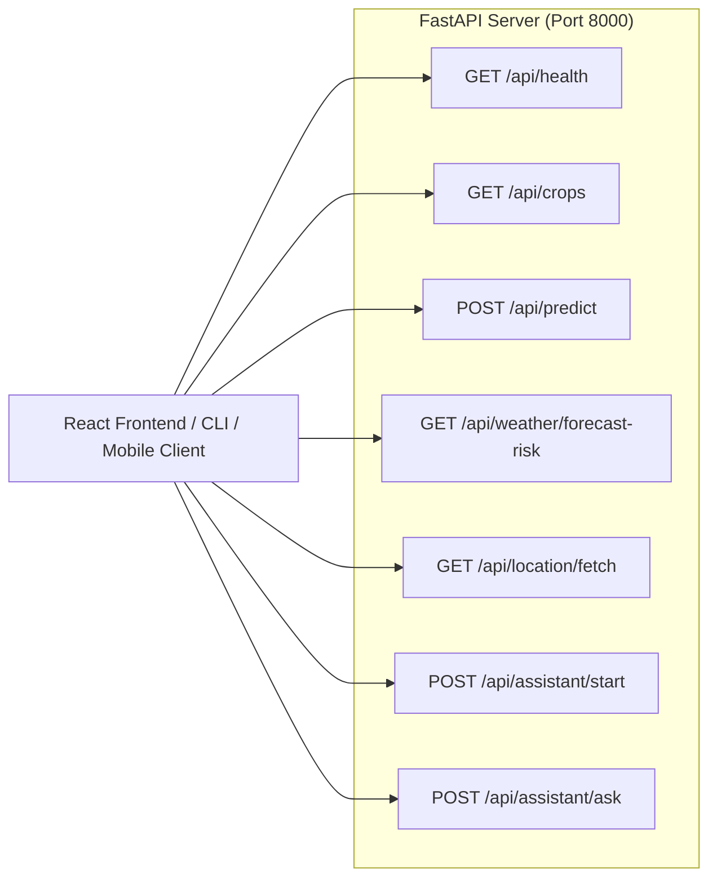

# FloraAI Plant Disease Detection Application Features

## 1. Application Overview

**FloraAI** is an agricultural diagnosis, explainability, and disease risk forecasting web application tailored for farmers, agronomists, and agricultural extension workers. The platform bridges computer vision and environmental phytopathology to deliver actionable, localized crop disease diagnoses.

---

## 2. Core Functional Features

### 2.1 Multimodal Crop Disease Detection
- **Supported Crops (4 Core Economic Staples):**
  - **Rice (*Oryza sativa*):** Brown Spot, Leaf Blast, Bacterial Leaf Blight, Healthy.
  - **Wheat (*Triticum aestivum*):** Leaf Rust, Stem Rust, Stripe / Yellow Rust, Loose Smut, Healthy.
  - **Sugarcane (*Saccharum officinarum*):** Red Rot, Yellow Leaf Disease, Smut, Healthy.
  - **Cotton (*Gossypium*):** Bacterial Blight, Alternaria Leaf Spot, Target Spot, Healthy.
- **Multimodal Deep Learning Architecture:**
  - **Visual Stream:** EfficientNetV2-S (300x300 RGB) producing 512-dimensional visual feature embeddings.
  - **Meteorological Stream:** 7-day $\times$ 11-feature sequence passed through 1D-CNN + 4-Head Attention producing 128-dimensional climate embeddings.
  - **Late Fusion:** Concatenated 640-dim representation mapped through an MLP classification head to 33 canonical disease classes.
  - **Inference Output:** Predicted disease class, top-3 confidence distribution, and lesion severity percentages.

### 2.2 Microclimate Epidemiological Risk Forecaster
- **Phytopathological Infection Pressure Engine (`backend/forecasting.py`):**
  - Models phytopathological equations including temperature suitability curves ($\mu = 27^\circ\text{C}, \sigma = 6^\circ\text{C}$), relative humidity thresholds ($RH \ge 80\%$), leaf wetness duration, and rainfall factors.
  - Evaluates deterministic infection pressure scores and computes softmax probabilities across Low, Medium, and High risk tiers with crop-specific multipliers.
- **SHAP (SHapley Additive exPlanations) Attribution:**
  - Computes exact cooperative game theory Shapley values across $2^4 = 16$ atmospheric feature subsets (Temperature, Humidity, Leaf Wetness, Rainfall) satisfying the efficiency axiom $\sum \phi_i = f(\mathbf{x}) - f(\mathbf{x}_{\text{base}})$.
- **7-Day Disease Progression Outlook:**
  - Projects rolling multi-day microclimate conditions and forecasts disease escalation risks (Low, Medium, High).
  - Outlines preventative spray windows and agronomic management advisories.
- **In-Memory Caching:**
  - Leverages `@lru_cache(maxsize=1)` for sub-millisecond risk evaluation under concurrent user load.

### 2.3 Grad-CAM Explainable AI (XAI)
- **Visual Saliency Maps:**
  - Generates Gradient-weighted Class Activation Mapping (Grad-CAM) overlays pinpointing the exact leaf pixel regions influencing the neural network's diagnosis.
  - Provides visual transparency to eliminate "black-box" model distrust among agronomists and farmers.
  - Calculates estimated affected leaf surface area percentage.

### 2.4 Interactive AI Agronomist Assistant
- **Mode A (Immediate Post-Prediction Synthesis):**
  - Synthesizes CNN diagnosis, top-3 probabilities, local microclimate context, and Grad-CAM lesion area into an immediate, easy-to-read diagnostic summary.
- **Mode B (Interactive Conversational Q&A):**
  - Stateful session handling (`POST /api/assistant/ask`) retaining diagnosis evidence.
  - Responds to farmers' follow-up questions regarding organic fungicide recipes, chemical dosage safety, drainage methods, and resistant crop varieties.
  - Resilient graceful fallback when external LLM API keys are not configured.

### 2.5 Multilingual Localization (8 Languages)
- Fully localized across English and 7 major Indic languages:
  1. English (`en`)
  2. Hindi (`hi` - हिन्दी)
  3. Gujarati (`gu` - ગુજરાતી)
  4. Marathi (`mr` - मराठी)
  5. Tamil (`ta` - தமிழ்)
  6. Telugu (`te` - తెలుగు)
  7. Bengali (`bn` - বাংলা)
  8. Punjabi (`pa` - ਪੰਜਾਬੀ)
- Translates disease common names, symptoms, biological causes, and organic/chemical remedies.

### 2.6 Progressive Web App (PWA) & Responsive UI
- Single-page React application with Tailwind CSS design.
- Fully responsive across desktop (1440px), tablet (768px), and mobile viewports (390px iPhone 14 standard) with zero horizontal overflow.
- Clean neutral color palette (`#F7F8F6` background, `#E4E7E2` borders, green primary action buttons).
- Offline-ready PWA manifest and service worker capabilities for rural field use.

### 2.7 Crop-Aware Dynamic Confidence Calibration & Disambiguation
- **Dynamic Unrecognized Cutoff:** Adapts rejection thresholds to crop class cardinality. Crops with 15 classes (Wheat) have a baseline uniform random chance of $1/15 \approx 6.67\%$. A calibrated 12% cutoff prevents premature leaf rejection and routes uncertain diagnoses to Tier 2 ("Not sure yet / multiple matches") displaying the top 3 candidates and Grad-CAM heatmap instead of displaying "We could not recognize this leaf".
- **Bayesian Margin Conditioning:** Calibrates conditioned probabilities using margin over uniform prior ($1/K$):
  $$\text{margin} = \frac{p - 1/K}{1 - 1/K}$$
- **Agronomic Knowledge Disambiguation:** Resolves overlapping disease names (e.g., separating Wheat Blast from Rice Blast) by injecting crop context into `get_disease_info(disease_name, lang, crop)`.

---

## 3. API Architecture & Endpoint Reference

| Method | Endpoint | Description | Request Payload | Response Attributes |
| :--- | :--- | :--- | :--- | :--- |
| `GET` | `/api/health` | Health probe & service status | None | `{"status": "ok", "service": "FloraAI"}` |
| `GET` | `/api/crops` | List of supported crop types | None | `{"crops": ["rice", "wheat", "sugarcane", "cotton"]}` |
| `POST` | `/api/predict` | Multimodal leaf disease prediction | `multipart/form-data` (`file`, `crop`, weather) | `predicted_class`, `confidence`, `top3`, `risk_level`, `disease_info`, `gradcam_image_b64` |
| `GET` | `/api/weather/forecast-risk` | Microclimate risk & 7-day progression | Query params (`crop`, `temperature_c`, `humidity_percent`, `rainfall_mm`) | `crop`, `current_assessment`, `seven_day_outlook` |
| `GET` | `/api/location/fetch` | Geolocation reverse lookup & weather | Query params (`lat`, `lon`) | `location`, `weather` |
| `POST` | `/api/assistant/start` | Initialise Mode A diagnostic session | JSON (`diagnosis_id`, `crop`, `predicted_class`, `confidence`) | `diagnosis_id`, `gemini_response`, `diagnosis_summary` |
| `POST` | `/api/assistant/ask` | Interactive Mode B conversation | JSON (`diagnosis_id`, `message` or `question`) | `chat_answer`, `follow_up_questions` |

