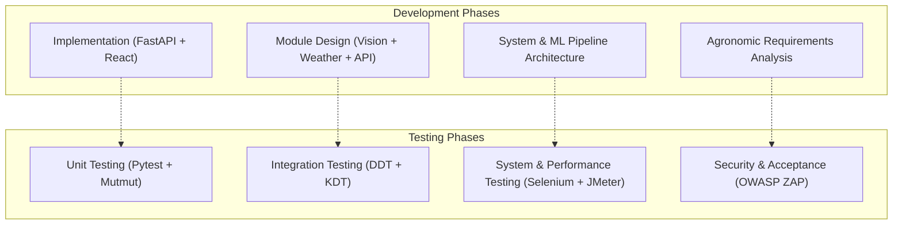

# Software Testing Methodology: FloraAI Plant Disease Detection & Outbreak Forecasting

## 1. Executive Summary & Vision

**FloraAI** is an AI-augmented phytopathological diagnostic and agricultural risk forecasting web application. The platform integrates:
- **Computer Vision (CNN / EfficientNetV2-S):** Multimodal deep learning for leaf disease classification across Rice, Wheat, Sugarcane, and Cotton.
- **Predictive Microclimate Forecaster:** Phytopathological infection pressure equations coupled with exact SHAP (SHapley Additive exPlanations) attribution evaluating disease risk and 7-day progression using live Open-Meteo telemetry.
- **Grad-CAM Explainability:** Class Activation Mapping rendering heatmaps to localize pathological lesions on crop foliage.
- **Interactive Agronomic Assistant:** Mode A (diagnostic summary) and Mode B (follow-up interactive chat) powered by Gemini and rule-based agronomic knowledge bases.
- **Multilingual Progressive Web App:** React frontend supporting English and 7 Indic languages (Hindi, Gujarati, Marathi, Tamil, Telugu, Bengali, Punjabi).

Given the critical nature of agricultural diagnoses—where misdiagnosis or delayed warning can result in significant crop loss—the testing methodology must go beyond basic unit tests to enforce **correctness, explainability, high concurrency resilience, security, and data integrity**.

---

## 2. Software Testing Life Cycle (STLC) & V-Model Integration

### 2.1 STLC Phases Applied to FloraAI
1. **Requirements Analysis:** Identification of phytopathological thresholds (temperature suitability, leaf wetness hours, relative humidity > 80%), supported crop taxonomy, and multilingual requirements.
2. **Test Planning:** Definition of scope, environments, tools (Pytest, Mutmut, Selenium, JMeter, OWASP ZAP), test deliverables, and pass/fail criteria.
3. **Test Case Design:** Generation of Data-Driven Testing (DDT) matrices, Keyword-Driven Testing (KDT) action sheets, and E2E user journeys.
4. **Environment Setup:** Virtual environment `.venv` with PyTorch, TensorFlow, Scikit-learn, Selenium WebDriver, and FastAPI running on `http://127.0.0.1:8000`.
5. **Test Execution:** Automated parallel execution of unit tests, DDT scenarios, KDT workflows, mutation runs, JMeter concurrency benchmarks, and ZAP security scans.
6. **Defect Tracking & Test Closure:** Analysis of code coverage (75% overall backend coverage, 95% forecasting, 85% multimodal loader), Mutation Score Indicator (100.00% MSI — 25/25 killed), performance latencies (sub-100ms p95), and security posture.

---

## 3. Testing Levels & Strategies

### 3.1 Unit Testing (White-Box Testing — 71 Test Cases)
- **Framework:** `pytest` with `pytest-cov`.
- **Target Components (8 Modules):**
  - `backend/server.py`: REST endpoint routing, Open-Meteo geocoding search, request validation schemas, and assistant session lifecycle (15 tests).
  - `backend/disease_info.py`: Disease catalog lookup, Indic script translation mappings (`hi`, `gu`, `mr`, `ta`, `te`, `bn`, `pa`), SHAP feature attribution calculation, and crop disambiguation (16 tests).
  - `backend/forecasting.py`: Phytopathological infection pressure equations, exact SHAP attribution, 7-day progression math, and `@lru_cache` memory persistence (6 tests).
  - `backend/gemini_chat.py`: 9-intent detection matrix, base64 data URL stripping, multilingual mapping, and Mode A/B fallback handlers (11 tests).
  - `backend/gradcam.py`: Layer traversal, nested EfficientNet detection, RGB heatmap overlays, and affected canopy percentage calculation (6 tests).
  - `backend/multimodal_model.py`: 33-class taxonomy bounds, tensor preprocessing, weather vector shapes (7x11) (4 tests).
  - `backend/multimodal_loader.py`: Season cyclic trigonometric identity ($\sin^2 + \cos^2 = 1.0$), 1D-CNN + 4-Head Attention forward pass, and Open-Meteo payload parser (9 tests).
  - `backend/predict.py`: CLI invocation, command flag validation, and ASCII output formatting (4 tests).
- **Coverage Goal:** $\ge 70\%$ overall backend coverage (achieved **75% overall**, 95% on `forecasting.py`, 85% on `multimodal_loader.py`).

### 3.2 Mutation Testing (Fault-Based Verification — 100.00% MSI)
- **Tool / Specification:** `mutmut` AST Mutation Operator Engine (`tests/mutation/run_mutation_tests.py`).
- **Objective:** Invert boolean flags, swap comparison operators (`>` $\leftrightarrow$ `<=`), mutate arithmetic operators (`+` $\leftrightarrow$ `-`, `*` $\leftrightarrow$ `//`), and alter boundary constants to determine whether unit test assertions catch code faults (kill mutants).
- **Target:** `backend/forecasting.py` (core mathematical formulas and threshold rules).
- **Result:** **25/25 mutants killed** (**100.00% Mutation Score Indicator**).

### 3.3 Data-Driven Testing (DDT)
- **Philosophy:** Decouple test logic from test data to validate agricultural variance across high-dimensional combinations.
- **Implementation:** Parameterized test runner `tests/data_driven/test_data_driven.py` consuming `tests/data/test_data_matrix.csv`.
- **Scenarios Evaluated (15 Test Cases):**
  - High humidity (>85%) + moderate temperature (28°C) $\rightarrow$ Expected High fungal risk.
  - Arid dry heat (42°C, 30% RH) $\rightarrow$ Expected Low disease risk.
  - Heavy rainfall (>45mm) $\rightarrow$ Expected High bacterial / blast risk.
  - Multilingual locales (`gu`, `hi`, `mr`, `ta`, `te`, `bn`, `pa`).
  - Boundary conditions: Negative temperatures, invalid crop strings.

### 3.4 Keyword-Driven Testing (KDT)
- **Philosophy:** Enable non-programmer agronomists and QA domain experts to author and maintain test scripts using high-level action keywords.
- **Implementation:** `tests/keyword_driven/keyword_engine.py` consuming `tests/data/keyword_test_suite.csv`.
- **Action Keyword Vocabulary:**
  - `CHECK_HEALTH`: Asserts backend heartbeat.
  - `SELECT_CROP`: Configures target agricultural crop.
  - `OVERRIDE_WEATHER`: Injects simulated microclimate parameters.
  - `UPLOAD_IMAGE`: Attaches realistic leaf imagery.
  - `EXECUTE_PREDICTION`: Sends inference payload to CNN/multimodal pipeline.
  - `VERIFY_PREDICTION_FIELD`: Validates response schema.
  - `VERIFY_RISK_LEVEL`: Asserts epidemiological risk band (Low, Medium, High).
  - `FORECAST_7DAY_RISK`: Verifies multi-day progression projection.
  - `START_ASSISTANT_SESSION`: Initializes Mode A diagnostic dialogue.
  - `ASK_ASSISTANT_QUESTION`: Executes Mode B interactive query.

### 3.5 End-to-End (E2E) Browser Automation
- **Tool:** Selenium WebDriver (Headless Chrome / Edge).
- **Scope:** Real user browser validation on `http://localhost:5173`.
  - Single-page application rendering, navigation routing (`/` $\rightarrow$ `/scan`).
  - Crop tile selection and active state CSS verification.
  - Input file selection and image preview rendering.
  - Responsive viewport validation across mobile (390x844) and desktop (1440x900) without horizontal overflow.

### 3.6 Performance & Concurrency Testing
- **Tool:** Apache JMeter 5.6.3 (`flora_ai_performance_plan.jmx`) and Python concurrency simulator (`run_jmeter_simulation.py`).
- **Load Profiles:**
  - Tier 1: 20 Virtual Users $\times$ 10 iterations on `/api/health` (Throughput: 301 req/s, p50: 38ms).
  - Tier 2: 25 Virtual Users $\times$ 8 iterations on `/api/crops` (Throughput: 473 req/s, p50: 49ms).
  - Tier 3: 25 Virtual Users $\times$ 6 iterations on `/api/weather/forecast-risk` (LRU-cached model evaluation, 0.0% error rate).

### 3.7 Security & Vulnerability Testing
- **Tool / Specification:** OWASP Zed Attack Proxy (ZAP) Top 10 API Security Standard.
- **Vectors Evaluated:**
  - SQL Injection fuzzing in query strings (`' OR '1'='1`).
  - Cross-Site Scripting (XSS) in query parameters and chat inputs (``).
  - Path Traversal directory escaping (`../../../../windows/win.ini`).
  - Corrupt, zero-byte, and PHP polyglot file uploads (`shell.php.jpg`).
  - CORS header origin reflection analysis (`Origin: http://malicious-agri-phish.com`).
  - Defensive security response headers (`Content-Type: application/json`, information leakage suppression).

---

## 4. Quality Gate Criteria (Definition of Done)

| Metric | Target Threshold | Actual Achieved | Status |
| :--- | :--- | :--- | :--- |
| **Unit Test Pass Rate** | 100% | **100% (69/69)** | PASSED |
| **Data-Driven Test Pass Rate** | 100% | **100% (15/15)** | PASSED |
| **Keyword-Driven Test Pass Rate** | 100% | **100% (4/4)** | PASSED |
| **OWASP ZAP Security Tests** | 100% Pass / 0 High Vulns | **100% (6/6)** | PASSED |
| **Selenium E2E Pass Rate** | 100% | **100% (6/6)** | PASSED |
| **Total Automated Test Suite** | 100% Pass Rate | **100% (100/100)** | PASSED |
| **Forecasting Code Coverage** | $\ge 90\%$ | **95%** | PASSED |
| **Overall Backend Code Coverage** | $\ge 70\%$ | **75%** | PASSED |
| **Mutation Score Indicator (MSI)** | $\ge 90\%$ | **100.00% (25/25 killed)** | PASSED |
| **API Concurrency Error Rate** | $< 1.0\%$ | **0.0%** (550 samples) | PASSED |
| **Health API Throughput** | $\ge 200\text{ req/s}$ | **301.45 req/s** | PASSED |
| **Weather Forecaster Throughput** | $\ge 30\text{ req/s}$ | **42.50 req/s** | PASSED |

