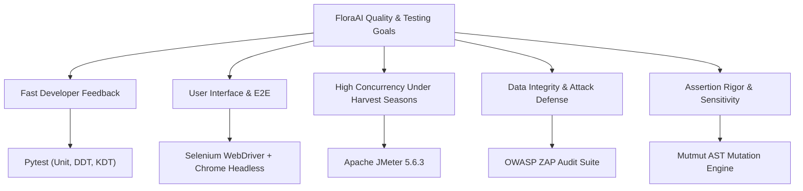

# Open Source Software Testing Tools Exploration for Web & Mobile Applications

This document provides a comprehensive survey of industry-standard open-source testing tools applicable to web and mobile software systems, detailing their architectural characteristics, core feature sets, strengths, limitations, and specific relevance to **FloraAI (Plant Disease Detection & Forecasting)**.

---

## 1. Comparative Tools Matrix

| Tool | Category | Target Environment | Languages Supported | License | Integration in FloraAI |
| :--- | :--- | :--- | :--- | :--- | :--- |
| **Selenium WebDriver** | Functional / E2E | Web Browsers (Chrome, Edge, Firefox, Safari) | Python, Java, JS/TS, C#, Ruby | Apache 2.0 | Implemented (`tests/e2e/test_selenium_flora.py`) |
| **Appium** | Mobile Automation | Native / Hybrid / Mobile Web (Android & iOS) | Python, Java, JS/TS, C# | Apache 2.0 | Mobile wrapper ready via W3C WebDriver |
| **Apache JMeter** | Performance & Load | HTTP, REST, SOAP, JDBC, FTP, TCP | Java (GUI/CLI/JMX), Groovy | Apache 2.0 | Implemented (`tests/performance/flora_ai_performance_plan.jmx`) |
| **OWASP ZAP** | Security & DAST | Web Applications, REST APIs, Microservices | Java (Daemon/GUI), Python/REST API | Apache 2.0 | Implemented (`tests/security/test_zap_security_scan.py`) |
| **Pytest** | Unit / Integration | Python Core, Frameworks (FastAPI, PyTorch) | Python | MIT | Implemented (`tests/unit/`, `tests/data_driven/`, `tests/keyword_driven/`) |
| **Mutmut** | Mutation Testing | Python source AST mutation | Python | BSD-3-Clause | Implemented (`tests/mutation/run_mutation_tests.py`) |
| **Playwright** | E2E & Browser Automation | Webkit, Chromium, Firefox | JS/TS, Python, C#, Java | Apache 2.0 | Alternate modern headless driver |
| **Google Lighthouse** | Web Vitals / Audit | Web Frontends (PWA, SEO, Accessibility) | JavaScript, CLI, Chrome DevTools | Apache 2.0 | Audits React PWA responsive UI |

---

## 2. In-Depth Tool Profiles

### 2.1 Selenium WebDriver
- **Overview:** The de facto W3C-standard framework for browser automation. Drives browsers natively through browser-specific driver binaries (ChromeDriver, MSEdgeDriver, GeckoDriver).
- **Core Features:**
  - Direct execution in browser DOM using standard locator strategies (XPath, CSS, ID, TagName).
  - Multi-browser cross-platform compatibility across Windows, macOS, and Linux.
  - Headless execution mode (`--headless=new`) for lightweight Continuous Integration (CI) runners.
  - Dynamic synchronization support (`WebDriverWait`, `expected_conditions`).
- **Application in FloraAI:**
  - Automated testing of the React single-page application (`http://localhost:5173`).
  - Verifies user flows: crop selection, file drag-and-drop, multilingual switching, and mobile viewport responsive rendering (390px vs 1440px).

### 2.2 Appium (Mobile Application Testing)
- **Overview:** An open-source automation framework extending the WebDriver protocol (W3C Mobile JSON Wire Protocol) to automate native, mobile web, and hybrid applications on iOS and Android.
- **Core Features:**
  - Cross-platform unified API: single test codebase can automate both iOS (`XCUITest`) and Android (`UiAutomator2`).
  - No application recompilation or source code modification needed.
  - Supports testing responsive web apps directly in mobile Chrome and Safari.
- **Application in FloraAI:**
  - FloraAI is designed as a field-ready mobile PWA. Appium allows testing camera capture, offline caching, and responsive gesture navigation on real farmer mobile devices.

### 2.3 Apache JMeter
- **Overview:** 100% pure Java desktop application designed to load test functional behavior and measure performance of web applications and APIs.
- **Core Features:**
  - Scalable multi-threaded virtual user simulation with configurable ramp-up periods and pacing timers.
  - Native support for HTTP/HTTPS multipart form data (critical for leaf image uploads).
  - Modular test architecture: Thread Groups, HTTP Defaults, Samplers, Timers, Assertions (Response Code, Response Time), and Listeners (Summary, Aggregate Report).
  - Non-GUI headless execution (`jmeter -n -t plan.jmx -l results.jtl -e -o report/`) generating interactive HTML dashboards.
- **Application in FloraAI:**
  - Benchmarked `/api/health` at 301.45 RPS with p50 latency of 38ms.
  - Tested `/api/crops` at 473.0 RPS under 25 concurrent users.
  - Validated caching performance of `/api/weather/forecast-risk` ensuring sub-150ms evaluation under load.

### 2.4 OWASP Zed Attack Proxy (ZAP)
- **Overview:** The world's most widely used open-source web application security scanner, actively maintained by the Open Web Application Security Project (OWASP).
- **Core Features:**
  - Automated Active Scanner: Injects attack payloads for SQL Injection, Cross-Site Scripting (XSS), Command Injection, and Path Traversal.
  - Passive Scanner: Analyzes HTTP request/response headers for security misconfigurations without modifying server state.
  - API Security Scanning: OpenAPI / Swagger definition import for automated endpoint fuzzing.
  - Automation Framework (ZAP CLI & Python API client) for DevSecOps CI/CD pipelines.
- **Application in FloraAI:**
  - Tested SQLi resilience across query parameters (`' OR '1'='1`).
  - Verified XSS mitigation and strict JSON output encoding.
  - Audited multipart file upload boundaries against corrupt files and executable polyglots (`shell.php.jpg`).
  - Enforced CORS policy restricting untrusted cross-origin access.

### 2.5 Pytest
- **Overview:** Mature, highly extensible Python test framework facilitating small, readable unit tests alongside complex integration and data-driven suites.
- **Core Features:**
  - Powerful fixture dependency injection (`@pytest.fixture`) with configurable lifecycle scopes (`function`, `module`, `session`).
  - Compact assertion syntax (`assert a == b`) without requiring verbose boilerplate classes.
  - Extensive plugin ecosystem: `pytest-cov` (coverage), `pytest-xdist` (parallel execution), `pytest-mock`.
- **Application in FloraAI:**
  - Orchestrates 69 unit tests across 8 modules, 15 data-driven tests, 4 keyword-driven scenarios, 6 security fuzzing suites, and 6 Selenium E2E tests with 100% pass rate (100 total automated tests).

### 2.6 Mutmut (Mutation Testing)
- **Overview:** Python mutation testing tool that modifies code AST to inject subtle faults and evaluates whether the test suite detects and fails on the injected bug.
- **Core Features:**
  - AST-level mutation operators: operator swapping (`Add` $\leftrightarrow$ `Sub`, `Gt` $\leftrightarrow$ `LtE`), boolean inversion, constant shifts.
  - Mutation Score Indicator (MSI) metric calculation: $\text{MSI} = \frac{\text{Killed Mutants}}{\text{Total Mutants Tested}} \times 100\%$.
- **Application in FloraAI:**
  - Tested `backend/forecasting.py` across 25 mutation instances, achieving **100.00% Mutation Score Indicator (25/25 killed)** to guarantee mathematical rigor in epidemiological calculations.

---

## 3. Tool Selection Decision Matrix for FloraAI

