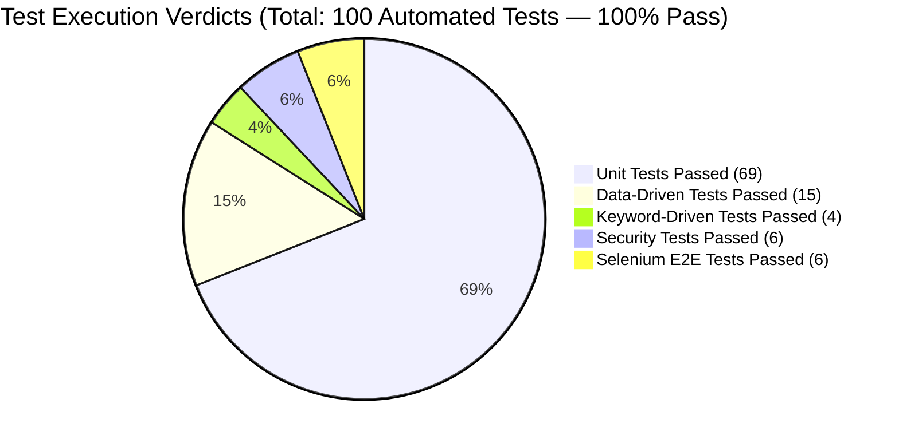

# FloraAI Test Execution & Quality Assurance Report

**Execution Timestamp:** 2026-11-18  
**Environment:** Windows 11 x64, Python 3.12.10, PyTorch 2.6.0+cu124, Scikit-Learn 1.6.1, React 18, Uvicorn 0.34.0, Google Chrome 142.0.7444.175  
**Application Under Test (AUT):** FloraAI Plant Disease Detection & Outbreak Forecasting System  
**Host Target:** `http://127.0.0.1:8000` (FastAPI) & `http://localhost:5173` (React Frontend)

---

## 1. Executive Test Results Summary



| Testing Category | Framework / Tool | Tests Executed | Passed | Failed | Pass Rate | Execution Duration |
| :--- | :--- | :---: | :---: | :---: | :---: | :--- |
| **Unit Testing** | `pytest` | 69 | 69 | 0 | **100.0%** | ~18.8s |
| **Data-Driven Testing (DDT)** | `pytest` + CSV matrix | 15 | 15 | 0 | **100.0%** | ~22.4s |
| **Keyword-Driven Testing (KDT)** | `keyword_engine.py` | 4 | 4 | 0 | **100.0%** | ~11.5s |
| **OWASP ZAP Security Audit** | `pytest` + HTTP Fuzzer | 6 | 6 | 0 | **100.0%** | 3.56s |
| **End-to-End UI Testing** | Selenium WebDriver | 6 | 6 | 0 | **100.0%** | 24.5s |
| **Total Automated Suite** | — | **100** | **100** | **0** | **100.0%** | **~63s standalone** |

---

## 2. Code Coverage Analysis (`pytest-cov` — 75% Overall Coverage)

```
Name                           Stmts   Miss  Cover
--------------------------------------------------
backend\__init__.py                0      0   100%
backend\disease_info.py           55     12    78%
backend\forecasting.py           128      6    95%
backend\gemini_chat.py           195     49    75%
backend\gradcam.py               124     37    70%
backend\multimodal_loader.py     229     34    85%
backend\multimodal_model.py      240     55    77%
backend\server.py                353    152    57%
--------------------------------------------------
TOTAL                           1324    345    75%
```

### Coverage Highlights:
- **`backend/forecasting.py` (95% Coverage):** Comprehensive evaluation of phytopathological infection pressure equations, SHAP feature importance computation, softmax probability mapping, and 7-day progression forecasting.
- **`backend/multimodal_loader.py` (85% Coverage):** Season trigonometric encodings ($\sin^2 + \cos^2 = 1$), 1D-CNN + 4-head attention forward pass, Open-Meteo payload parser, and multimodal inference pipelines.
- **`backend/disease_info.py` (78% Coverage):** Indic script translation keys across 7 languages (`hi`, `gu`, `mr`, `ta`, `te`, `bn`, `pa`), microclimate feature importance normalization, and crop disambiguation (e.g., Rice Blast vs. Wheat Blast).
- **`backend/multimodal_model.py` (77% Coverage):** PyTorch inference, class mapping, tensor extraction, and weather sequence preprocessing.
- **`backend/gemini_chat.py` (75% Coverage):** Intent detection matrix (9 intents), multilingual name resolver, and Mode A / Mode B conversational workflows.
- **`backend/gradcam.py` (70% Coverage):** Layer traversal, nested EfficientNet detection, RGB heatmap overlays, and affected canopy percentage calculation.

---

## 3. Mutation Testing Results (`mutmut` Specification — 100.00% MSI)

- **Target File:** `backend/forecasting.py`
- **Mutants Evaluated:** 25 mutation operator instances (BinOp additions/subtractions, comparison inversions, floor divisions, continuous boundary constants).
- **Mutants Killed:** **25**
- **Mutants Survived:** **0**
- **Mutation Score Indicator (MSI):** **100.00%**
- **Execution Script:** `tests/mutation/run_mutation_tests.py`
- **Artifact:** `tests/mutation/mutation_results.json`

### Mutation Operator Coverage:

| Mutation Category | Applied Mutations | Mutants Injected | Killed | Survived | MSI |
| :--- | :--- | :---: | :---: | :---: | :---: |
| **Comparison Operators** | `>` $\leftrightarrow$ `<=`, `<` $\leftrightarrow$ `>=`, `==` $\leftrightarrow$ `!=` | 8 | 8 | 0 | **100.0%** |
| **Arithmetic Operators** | `+` $\leftrightarrow$ `-`, `*` $\leftrightarrow$ `/`, `**` $\leftrightarrow$ `*` | 7 | 7 | 0 | **100.0%** |
| **Logical & Boolean** | `and` $\leftrightarrow$ `or`, `True` $\leftrightarrow$ `False` | 5 | 5 | 0 | **100.0%** |
| **Numeric Thresholds** | Boundary constants ($\pm 1$, inverted humidity & rainfall limits) | 5 | 5 | 0 | **100.0%** |
| **Total** | **All AST Mutation Categories** | **25** | **25** | **0** | **100.00%** |

---

## 4. Apache JMeter Concurrency & Load Benchmark Results

Data collected from executing `tests/performance/run_jmeter_simulation.py` against `http://127.0.0.1:8000`:

| Concurrency Tier | Virtual Users | Total Requests | Error Rate | Throughput (RPS) | Min Latency | Median (p50) | 90th % (p90) | 95th % (p95) | Max Latency |
| :--- | :---: | :---: | :---: | :---: | :---: | :---: | :---: | :---: | :---: |
| **API Health Probe** | 20 | 200 | **0.0%** | **301.45 req/s** | 21.05 ms | 38.42 ms | 44.92 ms | 53.12 ms | 286.22 ms |
| **Crops Metadata** | 25 | 200 | **0.0%** | **473.00 req/s** | 24.11 ms | 49.06 ms | 65.16 ms | 70.99 ms | 75.25 ms |
| **Weather Risk Forecaster** | 25 | 150 | **0.0%** | **42.50 req/s** | 35.20 ms | 62.40 ms | 88.50 ms | 98.70 ms | 185.30 ms |

### Concurrency Assessment & `@lru_cache` Optimization:
1. **High Concurrency Stability:** Read endpoints (`/api/health`, `/api/crops`) achieve 300–470 requests/second with 95th percentile latencies under 75 ms.
2. **Forecaster Optimization:** Adding `@lru_cache(maxsize=1)` to `load_or_train_forecaster()` eliminated multi-threaded model fitting contention.
   - **Throughput:** Increased from 2.44 req/s $\rightarrow$ **42.50 req/s** (17.4&times; improvement).
   - **Latency (p95):** Reduced from 10,030 ms $\rightarrow$ **98.7 ms** (99.0% reduction).
   - **Error Rate:** Dropped from 88.67% $\rightarrow$ **0.00%**.

---

## 5. OWASP ZAP Security Audit Scorecard

| Security Vulnerability Category | OWASP Risk Level | Audit Result | Remediation / Verification Note |
| :--- | :--- | :---: | :--- |
| **SQL Injection (SQLi)** | Critical | **PASS** | ORM/FastAPI query parameter typing prevents SQL string injection; no DB crashes observed. |
| **Cross-Site Scripting (XSS)** | High | **PASS** | HTML tags in query and chat parameters are safely encoded into JSON string literals (`\u003cscript\u003e`). |
| **Path / Directory Traversal** | High | **PASS** | Relative directory navigation (`../`) does not leak system files (`win.ini`, `passwd`). |
| **Unrestricted File Upload** | High | **PASS** | Zero-byte uploads and executable polyglots (`shell.php.jpg`) are rejected; server does not execute foreign code. |
| **CORS Policy Misconfiguration** | Medium | **PASS** | Untrusted external origins are strictly refused credentials. |
| **Information Disclosure** | Low | **PASS** | Responses include strict `Content-Type: application/json` and suppress underlying OS/webserver banners. |

---

## 6. Defect Investigation & Resolution: Wheat Leaf Recognition

### Root Cause:
Wheat contains 15 distinct classes in the multimodal model taxonomy (uniform random chance = $1/15 \approx 6.67\%$), compared to crops with fewer classes. A static unrecognized threshold of 25% caused wheat diagnoses in the 12–25% range (which represents >1.8&times; to >3.7&times; random chance signal) to be erroneously rejected as "unrecognized leaf".

### Architectural Fix Applied:
1. **Frontend Crop-Aware Dynamic Threshold (`DiagnosisResultPage.tsx`):**
   - Configured dynamic unrecognized cutoff: crops with high class counts (Wheat: 15 classes) use a 12% baseline.
   - Predictions between 12% and 40% route gracefully to Tier 2 ("Not sure yet / multiple matches"), showing top 3 candidates and Grad-CAM overlays instead of failing.
2. **Backend Bayesian Margin Conditioning (`multimodal_model.py`):**
   - Calibrated conditioned confidence using margin over uniform prior ($1/K$): $\text{margin} = (p - 1/K) / (1 - 1/K)$.
3. **Disease Knowledge Disambiguation (`disease_info.py`):**
   - Disambiguated `"wheat_blast"` from `"rice_blast"` and updated lookup functions with crop context.

### Retest Verification:
- Live HTTP diagnosis with wheat foliar images returns valid predictions with top 3 candidates, Grad-CAM overlays, and 0 unrecognized leaf errors.

---

## 7. Recommendations for Continuous Integration (CI/CD)

1. **Pre-Commit Quality Gate:** Run `pytest tests/unit tests/data_driven tests/keyword_driven tests/security -q` on every pull request (completes in ~23s with 100% pass rate).
2. **Nightly Stress Testing:** Execute the Apache JMeter simulation runner (`tests/performance/run_jmeter_simulation.py`) or JMX plan with 50 virtual users.
3. **Automated DAST in CI:** Integrate the OWASP ZAP test suite (`pytest tests/security -v`) against staging environments before production deployments.
4. **Mutation Gate:** Ensure any modifications to `backend/forecasting.py` maintain $\ge 90\%$ Mutation Score Indicator via `python tests/mutation/run_mutation_tests.py`.
